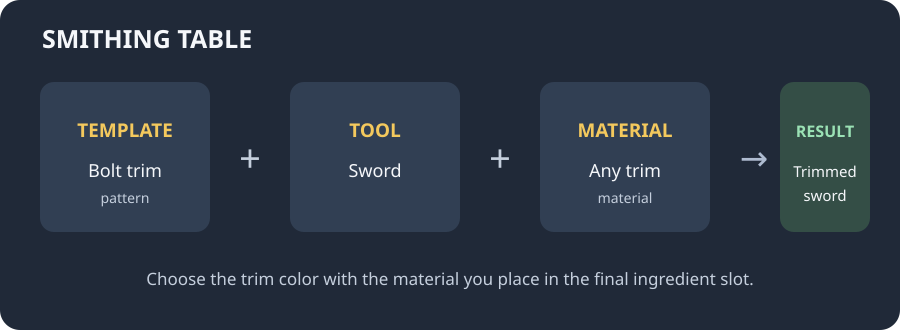
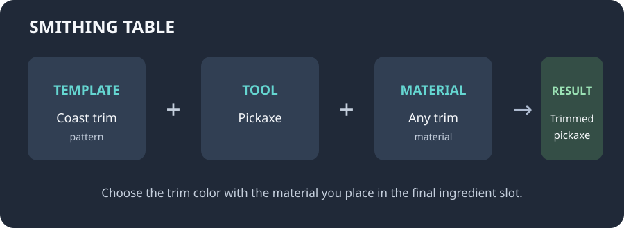

# Recipes

Every trim is made in a **smithing table** with three ingredients:

- **Template:** the armor trim pattern you want
- **Tool:** a supported sword, pickaxe, axe, shovel, or hoe
- **Material:** any trim material available in your Minecraft version

The diagrams below are simple guides to the smithing-table slots. They are not screenshots; item availability can vary by Minecraft version.

## Example: bolt-trimmed sword

Choose a Bolt armor trim template, put a sword in the tool slot, and add a trim material.

## Example: coast-trimmed pickaxe

Choose a Coast armor trim template, put a pickaxe in the tool slot, and add a trim material.

!!! note

    These are examples, not extra recipes to install. The mod uses the template and material items that exist in your Minecraft version.
